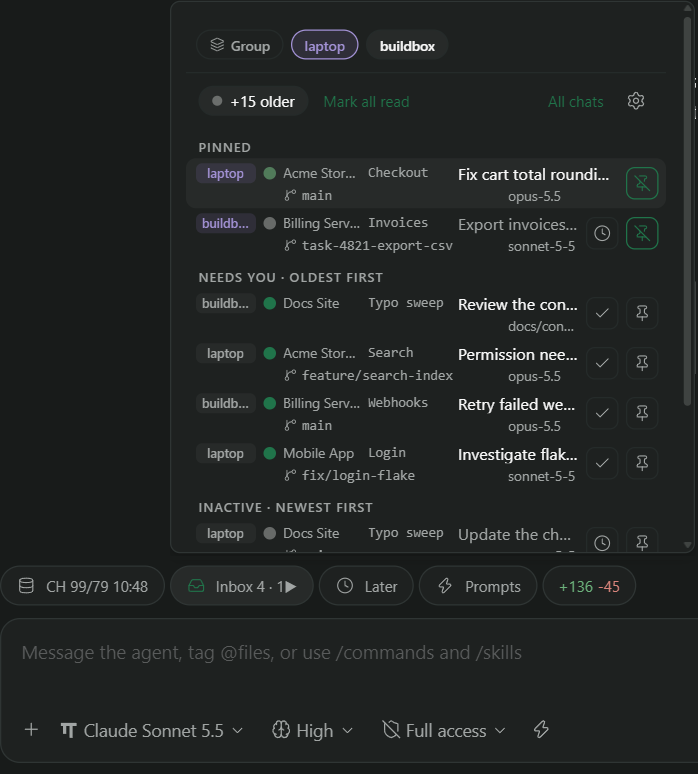
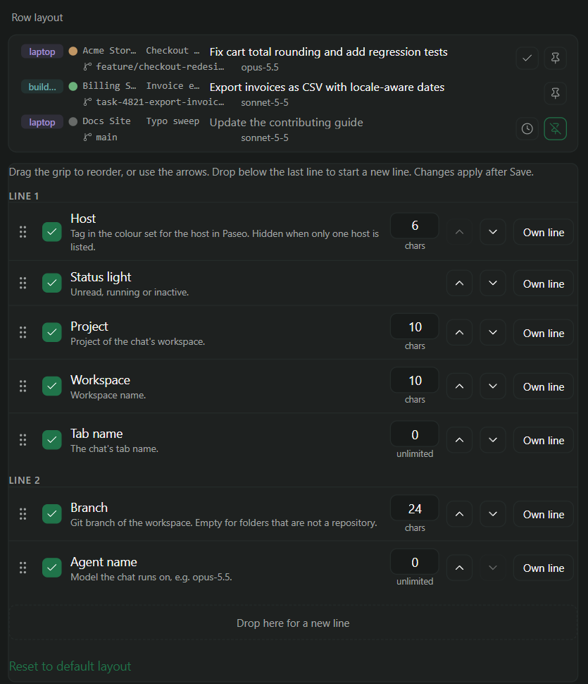

# Recent Chats for Paseo

My chat list got too long to read, so this plugin answers one question: what should I look at next?
It puts a short, ordered inbox of your chats in the sidebar and in a pill next to the composer.

Up front: I used AI to write a good part of the code and to help with the docs. The ideas, the
feature list and the trade-offs are mine. Read the source like any third-party code.

The inbox pill in a chat's composer, with sample data. One click opens the list, one click opens a chat:



The settings screen, where every row item can be shown, reordered, split over lines and given a length:



## What it does

- One row per chat, from every connected host. Default row: host tag, status light, project,
  workspace and tab name on the first line; git branch and agent on the second.
- Ordered by what needs you: unread chats oldest first, then running chats oldest first, then the most
  recently used inactive chats. Each group has its own limit, and `+N` chips show what is hidden. Section order and the sort direction in each are settings.
- Pinned chats stay at the top in their own section, whatever their state.
- A chevron on the Pinned, Running and Inactive headings, and on each host heading when grouped by host, folds that group away until you unfold it or restart the app.
- The chat open on screen is highlighted in every list. Plugins are not told which chat is open, so this works while the Inbox or Later pill is shown in its composer.
- Rename a chat in place: long press its row, or double-click it on desktop and web. The new title is saved on the chat's host through its `paseo agent update`, so that host needs a current Recent Chats.
- Opening a waiting chat leaves it in Needs you with a grey light until another chat is open or its state changes, so the list does not jump under the pointer.
- Lights: red waiting for you (fast pulse, also for an open question or permission request while the chat runs) or failed, orange running, green finished and unseen, grey inactive.
- **Sidebar view** (Settings, Sidebar, Sidebar view, "Recent Chats"): replaces the sidebar content with a Projects mode, a Needs you strip above a host, project, workspace and chat tree, and a Triage mode, the usual sections. Workspaces show their branch, checkout or worktree, the most urgent light of their chats, and buttons to pin the workspace in Paseo and to open it. Each workspace lists its three newest chats plus every chat that needs you, runs or is pinned; "Active only" folds projects with nothing inside the inactive window into a quiet list. The mode, Active only and folded nodes are kept per device.
- **Inbox pill** in every chat's composer with live counts and the same list as a popup.
- **Later pill** marks the chat you are in as unread and opens the next one.
- Check button on unread rows marks read without opening; clock button on inactive rows marks unread;
  pin button on every row.
- Fuzzy search over title, project, workspace, branch, agent and host. Host chips filter by host, and
  one chip groups rows per host.
- Full list screen, a cog that opens the settings, and a Command Center item.
- Settings: choose, reorder, split over any number of lines and set the length of every row item, with a
  live preview; list limits; the order of the sections and the sort direction inside each; the hover card with the full names and its transparency.

## Install

Plugins are trusted code, so read the source first. Then install it from GitHub on the daemon you want it on:

```bash
paseo plugin install github:SeriousM/paseo-recent-chats
```

`--ref <branch, tag or commit>` pins a revision (the default is the repository's default branch), and
The plugin updates itself: every host that installed it from GitHub checks a few minutes after start and every 6 hours, and runs `paseo plugin update` when a newer commit exists (Settings, Recent Chats, Updates switches this off). The newest version installed on any host is kept in the synced settings, so as soon as one host updates, the others follow within about a minute while a Paseo app is open. `paseo plugin update paseo-recent-chats` still updates at once. Plugins must be enabled on the daemon
(Settings, Plugins). In a desktop or web client the plugin then appears as "Recent Chats" in the sidebar.

## How unread works

A chat is unread when Paseo flags it as needing attention (finished, failed or waiting for a permission)
and you have not opened or dismissed it since. A running chat waiting for a permission counts as unread.
Unread chats older than the expiry (7 days by default) count as inactive.

Plugins cannot change Paseo's own read state, so "Later", "mark read without opening" and pins are stored
by the plugin, on the host the chat belongs to. Paseo's own status indicators do not show them.
A "Later" mark clears when you open the chat from this plugin; opening it from Paseo's own sidebar does not clear it.

## Where settings live

Install the plugin on every host you connect to. Each host's copy finds the others inside the app, so:

- Pins, Later and read marks are saved on the chat's own host. Every device and every host shows the same.
  While a chat's host is offline or has no copy of the plugin, its marks are kept on the current host and
  move to the chat's host once it is reachable.
- View settings (row layout, limits, list height, and the rest) are saved on every connected host. The most
  recently changed copy wins, so a host that was offline catches up when it is back. List height has
  separate settings for phones and wide screens.
- Settings earlier versions kept in a web or desktop profile are moved to the hosts on first start.

Copies of the plugin reach each other through a shared object in the app, not through a documented Paseo
API. If a future Paseo release isolates them, each host simply keeps its own marks and settings again.

## Limits

- Needs Paseo 0.16.0 or later (daemon and app). Hosts running an older version of this plugin keep their
  own marks and settings until updated.
- Host colours are read from the app's saved host list, so they show on web and desktop only.
- No keyboard shortcuts: plugins cannot register them. Use the Command Center.
- Sub-agents are not listed.

## Development

```bash
pnpm install
pnpm typecheck
pnpm test
paseo plugin install /absolute/path/to/paseo-recent-chats   # a local checkout
```

The plugin has a client entry (all the UI and logic) and a tiny server entry that only enables settings
storage. `client/web.ts` is the only file that touches a browser global. `client/peers.ts` is the shared
directory through which the copies of the plugin on different hosts reach each other; its shape is a
contract between plugin versions.

## License

MIT
